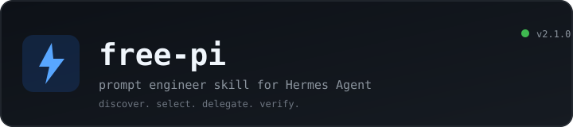

<div align="center">



**One prompt in. A precisely scoped prompt out. The agent writes no code.**

<a href="https://github.com/amiador017-commits/free-pi-skill/releases"></a>


**[Install](#install) · [Prompt](#prompt) · [How it works](#how-it-works) · [Security](#security-and-privacy) · [Usage](#usage) · [FAQ](#faq)**

</div>

---

> **Availability:** Currently available for **Hermes Agent only**. Support for other agents (Claude Code, Codex, opencode) is planned for a later release.

## The problem

You write a rough one-line prompt. The agent starts coding, picks its own model, guesses your reasoning level, and edits files before you can steer it.

## The fix

This skill puts the agent in one lane: **prompt engineer**. It reads your rough request, lets you pick the model and reasoning from a live list, hands one precise prompt to the [free-pi](https://freepi.ai) CLI, and reports back. It writes no code itself.

| | Without this skill | With this skill |
|---|---|---|
| Model | Chosen silently by the agent | Picked by you from a live popup |
| Reasoning | Guessed | Picked by you (`off` to `high`) |
| Prompt | Rough request passed through | Rewritten into one scoped, self-contained prompt |
| Who writes code | The agent, unpredictably | free-pi, always |
| Stale model names | Hardcoded in text | Re-discovered on every task |

## How it works

1. **Discover** the live free-unlimited models from free-pi's own catalog (`/client-version`). No cached list, no guessing.
2. **Ask** you in one popup: model + reasoning level.
3. **Launch** free-pi in a PTY, apply your picks, verify the footer and session JSONL.
4. **Submit** one precise prompt built from your rough request.
5. **Report** the result. The agent never writes or edits source itself.

The role boundary is written into the skill, not left to interpretation: zero code, zero file edits, no web search to answer your question, no taking over when free-pi stalls.

## Install

```bash
curl -fsSL https://raw.githubusercontent.com/amiador017-commits/free-pi-skill/v2.0.0/install.sh | bash
```

Or clone the repo and run `bash install.sh`. The installer writes only one file, `~/.hermes/skills/free-pi/SKILL.md`, and checks its SHA-256 before installing. It respects `$HERMES_HOME` for profile-specific installs.

Then start a **new** Hermes chat session. Skills in an open session are cached. Verify with:

```bash
hermes skills list | grep free-pi
```

Giving this repo to another agent? Point it at [`INSTALL.md`](INSTALL.md), which is the same procedure in agent-facing form.

## Prompt

Copy this whole block and paste it into **any agent chat** (Hermes, Claude Code, Codex, or another agent). It installs and verifies the skill without you running commands yourself.

````text
Install the free-pi skill from https://github.com/amiador017-commits/free-pi-skill into this machine's Hermes Agent skills directory.

Do exactly this:
1. Fetch and read https://raw.githubusercontent.com/amiador017-commits/free-pi-skill/v2.0.0/install.sh. Confirm it only writes ~/.hermes/skills/free-pi/SKILL.md and verifies a SHA-256 checksum. If it does anything else, stop and report it.
2. Run: curl -fsSL https://raw.githubusercontent.com/amiador017-commits/free-pi-skill/v2.0.0/install.sh | bash
3. Verify with: hermes skills list | grep free-pi
4. Report the installed path, the checksum printed, and tell me to start a NEW Hermes chat session so the skill loads.

Do not modify any other file. This skill is supported by Hermes Agent only for now. If Hermes is not installed here, stop and say so instead of installing anything.
````

## Usage

```
use free-pi to build a small landing page for my portfolio
```

A popup appears with the live model list and reasoning levels. After you confirm, free-pi does the work with your choices applied.

General chat questions do not trigger this skill.

## Security and privacy

This repo is **plain Markdown plus a small Bash installer**. No binaries, no executables, no build step, no telemetry, no package installation.

| Question | Answer |
|---|---|
| Does it contain secrets? | No. No token or API key is bundled. |
| What does the skill read? | Your own `~/.free-pi/agent/credentials.json`, at runtime. |
| Is the token ever printed? | No. It is used only in an Authorization header for the catalog call. |
| Network access | One GET to `https://api.freepi.ai/client-version` per task. Nothing else. |
| Files written by the installer | One: `SKILL.md` under your Hermes skills directory. |
| How do I verify the download? | The installer pins a tag and verifies SHA-256 before installing. |

Install only from `amiador017-commits/free-pi-skill`. Report anything suspicious through [SECURITY.md](SECURITY.md).

## FAQ

**Why a popup instead of a default in the prompt?**
Because a model that is free today may not be free tomorrow. The list is fetched live on every task.

**Which reasoning levels exist?**
`off`, `minimal`, `low`, `medium`, `high`. `high` is the maximum; the CLI rejects `max` and `xhigh`.

**What if the popup has more than four models?**
`clarify` allows four clickable choices; the rest are available through its "Other" row.

**Does Hermes verify the result?**
Yes, with build/test/grep commands. That is checking, not implementing; it never becomes Hermes writing code.

## Contributions

Contributions are **closed for now**. Bug reports are welcome through the issue tracker; please do not open pull requests yet.

## License

MIT. See [LICENSE](LICENSE). The skill text is also MIT; free-pi itself is a separate product with its own terms.
